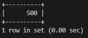
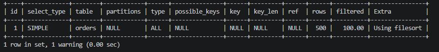
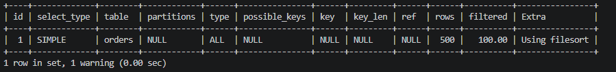
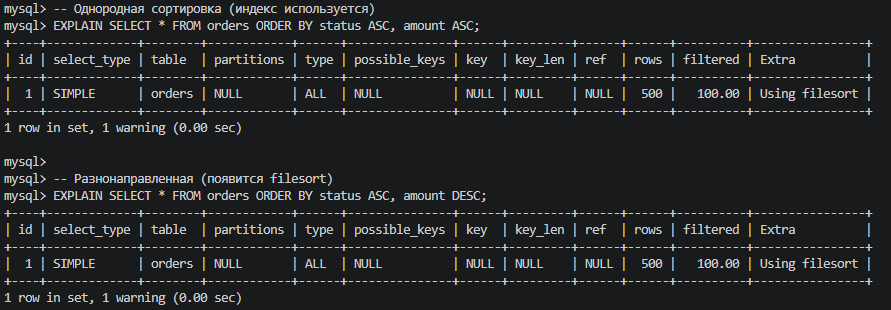
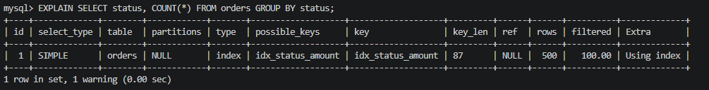
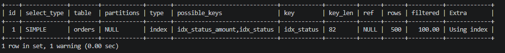
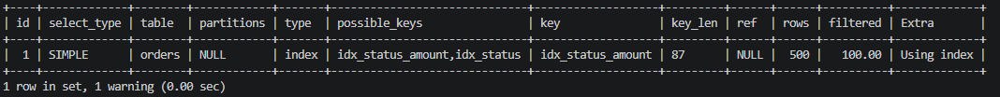
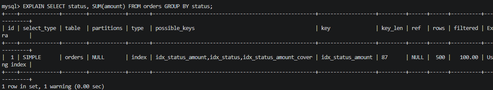
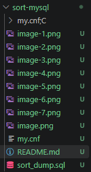

# Лабораторная работа: Ускорение сортировки и группировки в MySQL (ORDER BY / GROUP BY)

## Цель работы
Понять, когда MySQL выполняет `Using filesort` и `Using temporary`, и научиться проектировать индексы так, чтобы сортировка и группировка выполнялись за счёт порядка хранения данных.

## Ход работы
1. Создана база `sort_practice` и таблица `orders` (500 строк).
2. Продемонстрировано, что `ORDER BY amount` без индекса даёт `Using filesort`.
3. Создан индекс `idx_amount`, `filesort` исчез.
4. Показано влияние направления сортировки на использование индекса.
5. Продемонстрировано, что `GROUP BY status` без индекса даёт `Using temporary; Using filesort`.
6. Создан индекс `idx_status` (Loose Index Scan) — временная таблица исчезла.
7. Создан покрывающий индекс `idx_status_amount_cover` — получен `Using index`.
8. Создан дамп базы (`sort_dump.sql`).
9. Выгружен лог действий (`my_actions.log`).

## Скриншоты

### Создание БД и данных

### ORDER BY без индекса

### ORDER BY с индексом

### Направление сортировки

### GROUP BY без индекса

### GROUP BY с индексом

### Tight Index Scan

### Покрывающий индекс

### Файл дампа

### Файл лога

## Результаты
В папке проекта находятся:
- `sort_dump.sql` — дамп базы данных `sort_practice`.
- `my_actions.log` — отфильтрованный лог действий пользователя.